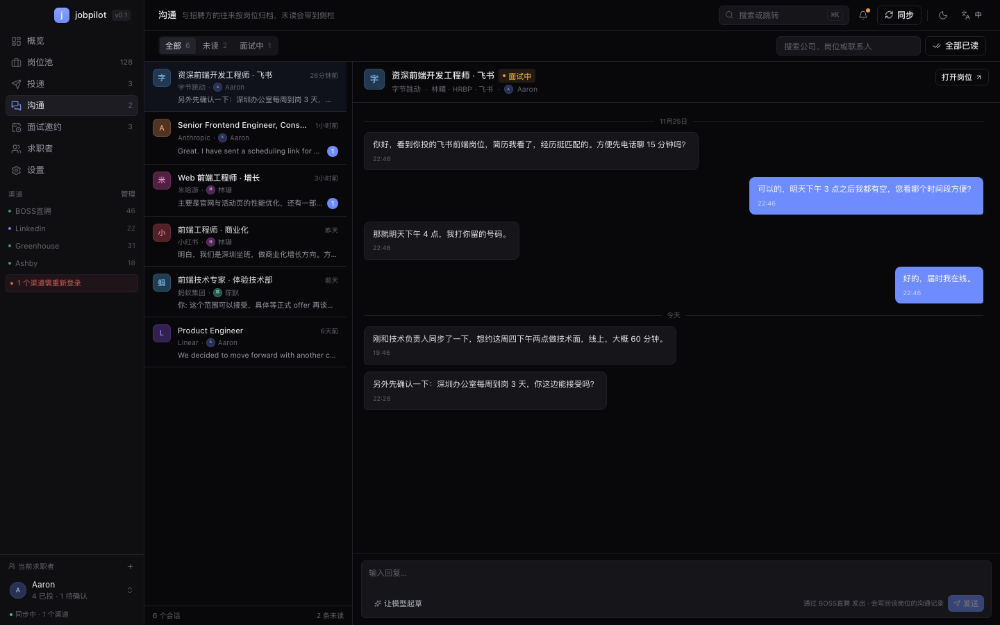

# jobpilot

求职助手桌面应用：把岗位发现、匹配评分、投递记录、沟通往来和面试邀约集中在一处管理，所有数据保存在本机。

## 功能

- **概览**：近 7 天的岗位发现、匹配、投递与沟通趋势，以及今日抓取分布
- **岗位池**：按工作方式、地区、雇佣类型、发布时间、匹配分数筛选，支持收藏与自定义视图
- **投递**：记录状态、简历快照与邮件正文，完整留痕
- **沟通**：按岗位归档往来邮件，支持未读标记与站内回复
- **面试邀约**：轮次、时间、形式、面试官与状态管理
- **求职者**：多份简历，各自独立的匹配结果
- **设置**：主题、语言、数据源与本地数据管理
- **SQL 日志**：开发模式下顶栏数据库图标可打开独立窗口，实时查看应用执行过的 SQL

## 界面预览

以下为示例数据下的深色主题界面，支持中英双语与明暗主题切换。

<table>
  <tr>
    <td></td>
    <td></td>
  </tr>
  <tr>
    <td></td>
    <td></td>
  </tr>
</table>

## 快速开始

需要 Node.js 与 pnpm。

```bash
pnpm install
pnpm dev          # 启动应用
pnpm typecheck    # 类型检查
pnpm build        # 构建到 src/apps/desktop/out
```

## 技术栈

Electron + React + TypeScript + Tailwind CSS + SQLite（better-sqlite3）+ Drizzle ORM。支持 macOS / Windows。

## 数据存储

数据库位于系统用户数据目录下的 `jobpilot.db`，首次启动自动建表并写入示例数据。设置页可恢复示例数据；简历正文只存本地，不上传云端。
