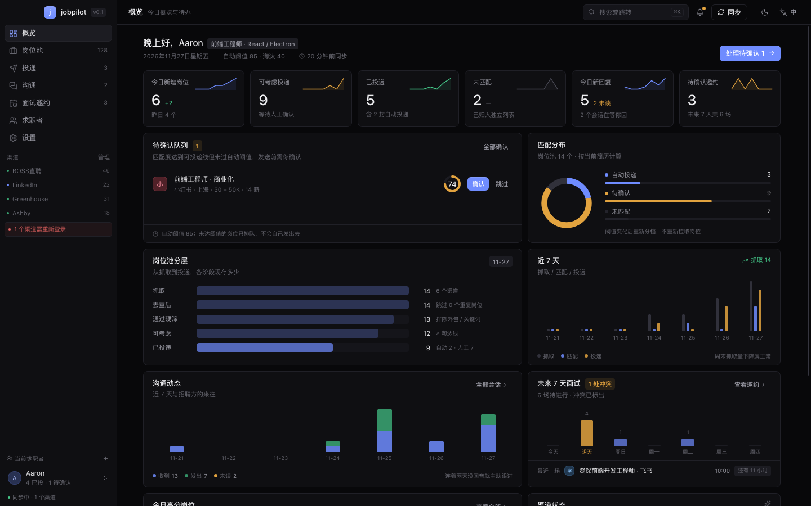
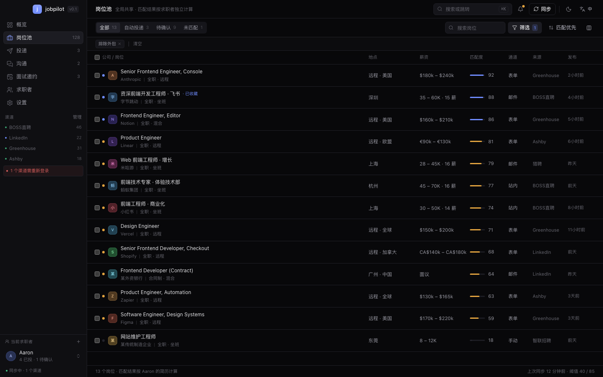

# jobpilot

求职助手桌面应用：把岗位发现、匹配评分、投递记录、沟通往来和面试邀约集中在一处管理，所有数据保存在本机。

## 功能

- **概览**：近 7 天的岗位发现、匹配、投递与沟通趋势，以及今日抓取分布
- **侧栏**：可折叠为纯图标窄栏，计数以角标气泡显示，渠道按品牌色块区分；折叠状态本地记忆
- **岗位池**：按工作方式、地区、雇佣类型、发布时间、匹配分数筛选，支持收藏与自定义视图
- **投递**：记录状态、简历快照与邮件正文，完整留痕
- **沟通**：按岗位归档往来邮件，支持未读标记与站内回复
- **面试邀约**：轮次、时间、形式、面试官与状态管理
- **求职者**：多份简历，各自独立的匹配结果；点击简历文件名可直接预览解析后的简历正文
- **设置**：模型模式与分场景模型界面、主题、渠道与本地数据管理；关于页展示版本、运行平台和更新入口（自动更新尚未接入）
- **SQL 日志**：开发模式下顶栏数据库图标可打开独立窗口，实时查看应用执行过的 SQL

## 界面预览

以下为示例数据下的深色主题界面，支持中英双语与明暗主题切换。

<table>
  <tr>
    <td></td>
    <td></td>
  </tr>
  <tr>
    <td></td>
    <td></td>
  </tr>
</table>

## 快速开始

需要 Node.js 与 pnpm。

```bash
pnpm install
pnpm dev          # 启动应用
pnpm typecheck    # 类型检查
pnpm build        # 构建到 src/apps/desktop/out
```

## 技术栈

Electron + React + TypeScript + Tailwind CSS + SQLite（better-sqlite3）+ Drizzle ORM。支持 macOS / Windows。

## 数据存储

数据库位于系统用户数据目录下的 `jobpilot.db`，首次启动自动建表并写入示例数据。设置页可恢复示例数据；简历正文只存本地，不上传云端。

## 当前进展与未完成事项

截至 2026-11-28：界面、本地数据库与读写链路已完成；后台匹配调度与档案禁用开关已接入（当前使用本地启发式打分）；简历正文已入库并可在求职者页预览。以下核心流程仍在使用示例数据或尚未接通。详细设计见 `docs/01-需求与架构方案.md`，接手须知见 `docs/02-项目交接文档.md`，工程纪律见 `docs/03-协作约定.md`。

### 一、核心业务链路（尚未跑通真实流程）

1. **渠道拉取（R1）**：`packages/core/src/source/types.ts` 定义了 `JobSource` / `ListProvider` / `DetailProvider` / `ApplyProvider`，但没有任何适配器实现；没有 Playwright worker 与 `utilityProcess`。`sources` 表中的渠道是种子数据，岗位池无法从真实渠道新增岗位。
2. **简历上传与解析（R2 / R9）**：简历正文已结构化入库（`resume_documents` / `resume_items`），求职者列表页与配置弹窗中点击简历文件名可打开预览；但**没有文件上传入口，也没有 PDF / DOCX 解析器**，正文当前来自预解析的示例数据。`resumeFile` / `resumePages` / `resumeFacts` 仍由种子写入，缺少「新建求职者 + 上传简历」的完整流程。
3. **大模型网关（R3）**：没有 LLM 网关与真实调用；`llm_usage` 是种子汇总而非调用统计。JD 结构化解析、匹配打分、求职信生成均未实现；设置页 API Key 只更新本地 state，不落库、不校验。设置页的模型配置需要拆成两种模式——**使用内置服务**（由服务端代理转发，用户无需提供密钥）与**用户自带 Key**（本地加密落库后直连供应商）；该形态尚未实现，方案见交接文档第八节。
4. **匹配分档与自动投递（R4）**：主进程每 30 秒扫描全部启用档案（不限当前选中者），禁用者跳过；只补算缺失分数，并记录扫描摘要。打分目前是本地确定性启发式（`heuristic-v1`），不是简历语义匹配；auto 档仍是筛选标签，没有自动发信执行器与日配额护栏。
5. **邮件投递（R8）**：没有 SMTP 发信代码；投递日志中的发送记录是种子文案。发前预览有 UI，但没有真实发送动作；主题规则未从 JD 自动抽取。
6. **IMAP 收信 / 回复追踪**：没有 IMAP 连接，无法判断 HR 是否回复，也无法自动更新会话阶段。

### 二、设置项与数据持久化

设置页中 API Key、模型供应商、渠道账号与更新频率、保护开关等控件只更新前端 state，刷新即丢失。求职者配置弹窗已可落库：基本资料、补充要求、匹配阈值、每日投递上限、发件邮箱，以及 SMTP 主机 / 端口与 POP3 主机 / 端口 / 启用开关；SMTP 密码与「测试发信」仍是占位。已接通的写操作包括：当前求职者、档案启用状态、档案配置、数据版本号、会话已读、发消息、面试状态、岗位收藏、投递状态与重置数据。

### 三、界面占位交互

| 位置 | 现状 | 待做 |
|---|---|---|
| 侧栏角标 | 岗位与投递数字写死 | 改为实时统计（折叠态已用气泡角标承载计数） |
| 面试「加入日历」 | 仅提示 | 生成 `.ics` 文件 |
| 备份 / 导出投递 / 导出岗位 | 仅提示 | 实现文件导出 |
| 添加渠道 | 仅提示 | 表单 + 适配器实例 |
| 自定义视图 | 有表与读取，无创建 UI | 补齐保存筛选为视图 |
| 沟通阶段标记 | 有定义，无写操作 | 接通 `setStage` |

### 四、工程质量

- 暂无自动化测试；`packages/core` 已按可脱离 Electron 单测的方式组织，但尚未编写用例。
- 暂无打包配置与自动更新；macOS / Windows 构建尚未实际验证。
- 技术选型文档中的 Zod / TanStack Query / Zustand / shadcn/ui 尚未采用，当前为手写参数校验、Context store 与手写 UI 组件。
- `llm_usage` 是汇总表，缺少 `llm_calls` 明细表。
- `docs/01-需求与架构方案.md` 顶部仍标记为草案，未反映已落地部分。

### 五、待决策的开放问题

1. 第一批接入哪些渠道？建议国内外各一个，验证抽象层。
2. auto 档自动投递的日配额上限。
3. 是否接入 IMAP / POP3 收信以追踪 HR 回复（弹窗里已可配置 POP3，但尚无收信任务）。
4. auto / reject 默认阈值是否定为 85 / 40。
5. 求职信是否需要英文等多语言支持。
6. 面试邀约来自平台同步还是从邮件正文抽取。

### 建议推进顺序

设置持久化 → 简历上传与解析 → LLM 网关与打分流水线（替换 `heuristic-v1`） → SMTP 发信 → 单渠道适配器与浏览器自动化 → IMAP 收信、打包签名与自动更新。
